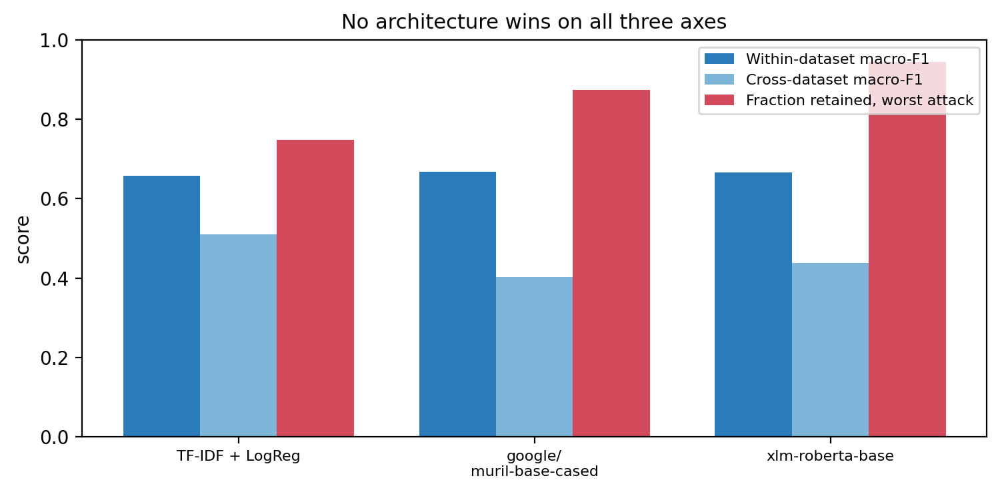

# Report tables

Generated by `notebooks/15_report_tables.ipynb`. Do not edit by hand: re-run the notebook instead, so the numbers in the report can never drift from the numbers in the result files.

## Table 1. Corpus composition

*Table 1. Source corpora before and after the romanised filter.*

| Corpus              |   Posts |   Hate % |   Romanised |   Romanised % |
|:--------------------|--------:|---------:|------------:|--------------:|
| Bohra et al. (2018) |    4574 |     36.3 |        4574 |         100   |
| HASOC 2021 ICHCL    |    4911 |     47.8 |        4335 |          88.3 |
| HASOC 2022 ICHCL    |    4901 |     51.4 |        4306 |          87.9 |
| Total               |   14386 |    nan   |       13215 |         nan   |

## Table 2. Feature ablation, baseline

*Table 2. Feature ablation, five-fold cross-validation on the training split.*

| Feature set       |   Macro-F1 |    SD |   Accuracy |   Precision |   Recall |
|:------------------|-----------:|------:|-----------:|------------:|---------:|
| word-only TF-IDF  |      0.622 | 0.01  |      0.644 |       0.621 |    0.626 |
| word+char+lexicon |      0.657 | 0.005 |      0.68  |       0.656 |    0.658 |

## Table 3. Within-dataset comparison

*Table 3. Best configuration per model, frozen 915-post test set.*

| Model                             | Protocol     | Epochs   | LR       | Macro-F1   | Hate F1   | Not-hate F1    | Accuracy      |
|:----------------------------------|:-------------|:---------|:---------|:-----------|:----------|:---------------|:--------------|
| epochs                            | lr           | seed     | macro_f1 | hate_f1    | accuracy  | cross_macro_f1 | cross_hate_f1 |
| ai4bharat/indic-bert              | single split | 6        | 3e-5     | 0.671      | 0.577     | 0.764          | 0.697         |
| google/muril-base-cased           | 3-seed mean  | 6        | 2e-05    | 0.667      | 0.560     | 0.775          | 0.703         |
| xlm-roberta-base                  | 3-seed mean  | 3        | 2e-05    | 0.665      | 0.590     | 0.740          | 0.682         |
| TF-IDF word+char+lexicon + LogReg | 5-fold CV    |          |          | 0.657      | 0.567     | 0.729          | 0.68          |
| ai4bharat/IndicBERTv2-MLM-only    | 3-seed mean  | 6        | 2e-05    | 0.656      | 0.566     | 0.747          | 0.681         |
| TF-IDF word-only + LogReg         | 5-fold CV    |          |          | 0.622      |           |                |               |
| 3                                 | 2e-5         | 1337     | 0.672    | 0.609      | 0.684     | 0.406          | 0.158         |
| 6                                 | 2e-5         | 2024     | 0.667    | 0.6        | 0.68      | 0.384          | 0.113         |

**Degenerate runs, reported for completeness:**

*Runs that collapsed to a single predicted class.*

| model                   |   epochs |    lr |   within_macro_f1 |   within_hate_f1 | note                                                                                                                                                 |
|:------------------------|---------:|------:|------------------:|-----------------:|:-----------------------------------------------------------------------------------------------------------------------------------------------------|
| xlm-roberta-base        |        6 | 3e-05 |             0.312 |            0.531 | DEGENERATE: loss flat at ln(2)=0.693; predicted hate for 874/915. Cross hate-F1 0.673 is an artefact of all-hate prediction on a 51.3% hate test set |
| google/muril-base-cased |        6 | 3e-05 |             0.389 |            0     | DEGENERATE: predicts the non-hate class for every test example                                                                                       |

## Table 4. Sensitivity to change of seed

*Table 4. Mean and standard deviation over three seeds (42, 1337, 2024).*

| Model                   |   Seeds | Within-dataset macro-F1   | Hate F1       | Cross-dataset macro-F1   |
|:------------------------|--------:|:--------------------------|:--------------|:-------------------------|
| google/muril-base-cased |       3 | 0.667 ± 0.015             | 0.560 ± 0.036 | 0.403 ± 0.035            |
| xlm-roberta-base        |       3 | 0.665 ± 0.008             | 0.590 ± 0.018 | 0.438 ± 0.027            |

> Baseline for comparison: within 0.657 ± 0.005 (five-fold CV), cross 0.510.

## Table 5. Cross-dataset transfer

*Table 5. Transfer to a corpus never seen in training.*

| Model                   |   Within | Cross (HASOC 2022)   |   Absolute drop |   Relative drop % |
|:------------------------|---------:|:---------------------|----------------:|------------------:|
| TF-IDF + LogReg         |    0.657 | 0.510                |           0.147 |              22.4 |
| google/muril-base-cased |    0.667 | 0.403 ± 0.035        |           0.265 |              39.6 |
| xlm-roberta-base        |    0.665 | 0.438 ± 0.027        |           0.228 |              34.2 |

> The baseline transfers best. Every transformer transfers worse than the statistical model, by a margin far larger than the seed spread in Table 4.

## Table 6. Adversarial attack

*Table 6. Performance under attack at full perturbation rate.*

| Model                   |   Clean macro-F1 |   Romanisation macro-F1 |   Romanisation drop % |   Romanisation realised |   Character macro-F1 |   Character drop % |   Character realised |
|:------------------------|-----------------:|------------------------:|----------------------:|------------------------:|---------------------:|-------------------:|---------------------:|
| TF-IDF + LogReg         |            0.642 |                   0.594 |                   7.5 |                   0.762 |                0.48  |               25.2 |                 0.71 |
| google/muril-base-cased |            0.667 |                   0.625 |                   6.4 |                   0.762 |                0.583 |               12.6 |                 0.71 |
| xlm-roberta-base        |            0.665 |                   0.628 |                   5.5 |                   0.762 |                0.642 |                3.5 |                 0.71 |

> The transformers are markedly less affected by character corruption than the baseline. Subword tokenisation re-segments a damaged word into valid pieces and context recovers the meaning; the TF-IDF features have no context to fall back on.

## Table 7. Confusion matrix counts

> confusion_counts.csv not found. Run notebook 14 first.

## Table 8. Confidence-weighted score

> confidence_scores.csv not found. Run notebook 14 first.

## Table 9. Error analysis of missed hate posts

> Categorised file not found in writing/. **Commit `true_hate_MISSED_categorised.csv` to the repository** — it is the only artefact of the hand annotation and it is currently untracked. Table 9 filled from the recorded counts in the meantime.

*Table 9. Categories of missed true-hate posts (n=140).*

| Code   | Category                                    |   Posts |   % of misses |
|:-------|:--------------------------------------------|--------:|--------------:|
| C      | Political criticism labelled as hate        |      58 |          41.4 |
| E      | Would not be called hate speech on reading  |      26 |          18.6 |
| A      | Implicit group hate, no explicit slur       |      19 |          13.6 |
| B      | Slur present but absent from the lexicon    |      10 |           7.1 |
| F      | Ambiguous without further context           |       9 |           6.4 |
| H      | Personal abuse, no group target and no slur |       8 |           5.7 |
| D      | Too short to classify                       |       5 |           3.6 |
| G      | Direct threat                               |       5 |           3.6 |

*Table 9b. Lexicon coverage on caught against missed posts.*

| group   |   n |   mean_words |   mean_chars |   mean_lexicon_hits |   pct_zero_lexicon |   pct_mention |   pct_hashtag |   pct_url |   mean_p_hate |
|:--------|----:|-------------:|-------------:|--------------------:|-------------------:|--------------:|--------------:|----------:|--------------:|
| CAUGHT  | 192 |         22.9 |        123.4 |                1.65 |                1   |          14.1 |           9.4 |       5.7 |          0.67 |
| MISSED  | 140 |         19.5 |        103.4 |                1.06 |               12.1 |          10.7 |           1.4 |       7.9 |          0.36 |

## Summary figure: the three-way trade-off

